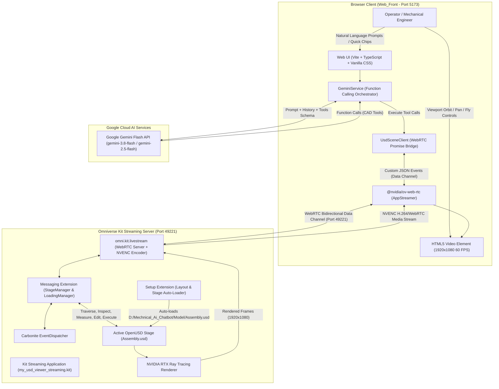
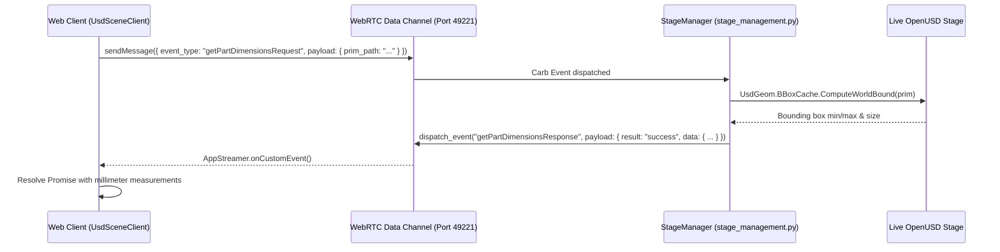

# Mechanical AI Digital Twin & Chatbot Architecture

## Executive Overview

The **Mechanical AI Digital Twin** connects a high-performance web dashboard to an authoritative, live 3D engineering simulation running in **NVIDIA Omniverse Kit**. The system streams photorealistic, hardware-accelerated RTX ray-traced visuals of an automotive **Disc Brake Assembly** (`Assembly.usd`) directly into a browser using WebRTC, while pairing the live viewport with an autonomous **Multimodal Mechanical AI Copilot** powered by Google Gemini Flash.

Unlike static 3D viewers or disconnected chatbots, this architecture provides a **closed-loop, bidirectional digital twin bridge**:
1. **Authoritative OpenUSD Execution**: The 3D scene graph, geometric tolerances, CAD transforms, and MDL/PBR materials remain authoritative on the Omniverse Kit host.
2. **Interactive 1080p 60 FPS Viewport**: The browser renders the hardware-decoded WebRTC stream using `@nvidia/ov-web-rtc` and provides smooth camera orbiting, panning, fly mode, and direct prim picking.
3. **USD Scene API Grounding**: An in-engine Python messaging extension (`StageManager`) exposes 14 CAD inspection, navigation, and write-authoring endpoints over the WebRTC data channel.
4. **Autonomous AI Function Calling**: The Gemini Flash Copilot translates natural-language queries into structured tool invocations (`get_scene_summary`, `get_assembly_hierarchy`, `inspect_prim`, `get_part_dimensions`, `focus_camera_on_part`, `set_part_visibility`, `set_material_color`, `bind_material`, `execute_usd_code`). Gemini queries live scene state before answering and executes real-time stage modifications with zero manual coding from the operator.
5. **Interactive CAD Chat Integration**: Part names generated in chat responses become clickable badges (`.part-tag`), enabling operators to click any mentioned mechanical component to instantly highlight and frame the 3D camera on it.

---

## System Context Diagram



---

## Repository Structure & Submodule Layout

```text
d:\Mechnical_Ai_Chatbot\
├── ARCHITECTURE.md                  # Comprehensive architectural reference (this document)
├── start_streaming_server.bat       # Launches Omniverse Kit headless streaming server with Assembly.usd
├── start_web_client.bat             # Starts Vite development server for Web_Front (Port 5173)
├── stop_all.bat                     # Cleanly terminates kit.exe and frees port 5173
│
├── Model\                           # Authoritative CAD Digital Twin Assets
│   ├── Assembly.usd                 # Binary OpenUSD stage (71 MB) containing Disc Brake Assembly
│   └── Assembly.usda                # Human-readable ASCII USD stage (264 MB) for inspection & diffing
│
├── Web_Front\                       # High-Performance Web Dashboard
│   ├── index.html                   # Application layout, viewport container, chat drawer, API key modal
│   ├── package.json                 # Node dependencies (@nvidia/ov-web-rtc 6.x, Vite 6.2, TypeScript)
│   ├── vite.config.ts               # Vite bundler configuration
│   └── src\
│       ├── main.ts                  # App coordinator, WebRTC lifecycle, quick chips, part-click delegation
│       ├── index.css                # Glassmorphism design system, NVIDIA green tokens, micro-animations
│       └── services\
│           ├── usdSceneClient.ts    # Promise-based request/response bridge over WebRTC data channel
│           └── geminiService.ts     # Gemini Flash function-calling orchestrator & CAD tools catalog
│
├── kit-app-template\                # Omniverse Kit Application & Extension Workspace
│   ├── repo.bat / repo.sh           # Repository build toolchain
│   ├── source\
│   │   ├── apps\
│   │   │   ├── my_company.my_usd_viewer.kit           # Base USD viewer application definition
│   │   │   └── my_company.my_usd_viewer_streaming.kit # Streaming application with WebRTC & NVENC locked to 60 FPS
│   │   └── extensions\
│   │       ├── my_company.my_usd_viewer_setup_extension\      # Asynchronous stage loading & viewport layout
│   │       └── my_company.my_usd_viewer_messaging_extension\  # StageManager handling USD Scene API requests
│   └── _build\windows-x86_64\release\                         # Compiled Kit binaries (kit.exe)
```

---

## Component Responsibilities

| Component | Path / Package | Primary Responsibilities |
|---|---|---|
| **Web Client Host** | [`Web_Front/src/main.ts`](file:///d:/Mechnical_Ai_Chatbot/Web_Front/src/main.ts) | Manages application bootstrap, WebRTC stream configuration, status badges, connection retries, and delegates user clicks on interactive part chips. |
| **USD Scene Client** | [`Web_Front/src/services/usdSceneClient.ts`](file:///d:/Mechnical_Ai_Chatbot/Web_Front/src/services/usdSceneClient.ts) | Wraps `@nvidia/ov-web-rtc` custom messaging in asynchronous Promises with unique correlation and 10s timeouts for robust request/response RPC. |
| **AI Copilot Service** | [`Web_Front/src/services/geminiService.ts`](file:///d:/Mechnical_Ai_Chatbot/Web_Front/src/services/geminiService.ts) | Manages Google Gemini Flash multi-turn conversation, model catalog discovery, resilient fallback handling (503/429/500/404), CAD tool declarations, and tool execution. |
| **Design System** | [`Web_Front/src/index.css`](file:///d:/Mechnical_Ai_Chatbot/Web_Front/src/index.css) | Custom glassmorphism dark mode (`#0a0d14`), NVIDIA green accents (`#76b900`), cyan telemetry glows, responsive split-screen viewport layout, and animations. |
| **WebRTC SDK** | `@nvidia/ov-web-rtc` (v6.x) | Manages WebRTC peer connection, SDP negotiation, H.264 video decoding, mouse/keyboard input capture, and bidirectional data channel communication. |
| **Kit Streaming App** | [`kit-app-template/source/apps/my_company.my_usd_viewer_streaming.kit`](file:///d:/Mechnical_Ai_Chatbot/kit-app-template/source/apps/my_company.my_usd_viewer_streaming.kit) | Configures Kit SDK with `omni.kit.livestream.app`, `omni.kit.livestream.webrtc`, locks renderer resolution to $1920 \times 1080$, and pins framerate to 60 FPS. |
| **Setup Extension** | [`my_company.my_usd_viewer_setup_extension`](file:///d:/Mechnical_Ai_Chatbot/kit-app-template/source/extensions/my_company.my_usd_viewer_setup_extension/my_company/my_usd_viewer_setup_extension/setup.py) | Reads `--/app/auto_load_usd`, verifies file resolution, waits for stage readiness, opens the stage asynchronously, hides default menu bars, and enforces viewport layouts. |
| **Messaging Extension** | [`my_company.my_usd_viewer_messaging_extension`](file:///d:/Mechnical_Ai_Chatbot/kit-app-template/source/extensions/my_company.my_usd_viewer_messaging_extension/my_company/my_usd_viewer_messaging_extension/stage_management.py) | Registers 14 incoming and outgoing WebRTC custom events, inspects USD hierarchy, computes physical bounding boxes with `UsdGeom.BBoxCache`, edits materials, and executes custom USD Python code. |
| **Digital Twin USD Model** | [`Model/Assembly.usd`](file:///d:/Mechnical_Ai_Chatbot/Model/Assembly.usd) / [`Assembly.usda`](file:///d:/Mechnical_Ai_Chatbot/Model/Assembly.usda) | Authoritative CAD model of the Disc Brake Assembly with root prim `/World/Disc_Brake_Assembly`, component sub-assemblies, and high-quality MDL/PBR materials in `/World/Looks`. |

---

## Authoritative USD Model Anatomy (`Assembly.usd`)

The scene represents a complete automotive disc brake mechanical system configured with centimeter units (`metersPerUnit = 0.01`) and Y-up orientation (`upAxis = "Y"`).

```text
/World
├── Looks/                               # Stage Materials Library (MDL / OmniPBR)
│   ├── Metal_Yellow_Paint               # High-temp yellow lacquer applied to Brake Caliper
│   ├── Aluminum_Anodized                # Machined anodized aluminum for caliper mount / brackets
│   ├── Metal_Ceramic_Brakes_Clean       # Ceramic composite friction material on brake pads
│   ├── Metal_Silver_Paint               # Silver protective finish
│   ├── Metal_Grain_01                   # Cast steel grain texture
│   ├── Pristine_Metal_Polished_01 / 02  # Polished stainless steel finishes
│   └── material__980392_...             # Specialized CAD import material layers
│
├── Disc_Brake_Assembly/                 # Root Mechanical Assembly (Xform)
│   ├── occurrence_of_Brake_Caliper/
│   │   └── Brake_Caliper/
│   │       └── mesh67_mesh              # Hydraulic twin-piston caliper housing (Mesh: vertices & faces)
│   ├── occurrence_of_Caliper_Mount/
│   │   └── Caliper_Mount                # Rigid structural mounting bracket to suspension knuckle
│   ├── occurrence_of_Mounting_Bolt/
│   │   └── Mounting_Bolt                # Upper high-tensile caliper mounting fastener
│   ├── occurrence_of_Mounting_Bolt_001/
│   │   └── Mounting_Bolt_001            # Lower high-tensile caliper mounting fastener
│   ├── occurrence_of_brake_pads/
│   │   └── brake_pads                   # Inboard friction brake pad assembly
│   ├── occurrence_of_brake_pads_001/
│   │   └── brake_pads_001               # Outboard friction brake pad assembly
│   ├── occurrence_of_rotor_disc/
│   │   └── rotor_disc                   # Ventilated cast-iron brake disc with cooling vanes
│   └── occurrence_of_hub_and_studs/
│       └── hub_and_studs                # Central wheel hub assembly with wheel studs
│
└── Camera                               # Primary perspective viewport camera
```

---

## WebRTC Bidirectional Message Contract

Communication between the web browser and Omniverse Kit occurs over WebRTC custom data channel messages. Messages are encapsulated as JSON objects with `event_type` and `payload`.



### 1. Inspection & Analysis Message Types

| Request Event | Response Event | Direction | Key Payload Attributes | Omniverse Kit Operation |
|---|---|---|---|---|
| `getSceneSummaryRequest` | `getSceneSummaryResponse` | Browser $\leftrightarrow$ Kit | `summary`: `{ stage_name, up_axis, meters_per_unit, total_prims, mesh_count, assemblies, root_components }` | Traverses stage, counts prim types, identifies root assemblies under `defaultPrim`. |
| `getAssemblyHierarchyRequest` | `getAssemblyHierarchyResponse` | Browser $\leftrightarrow$ Kit | Request: `{ root_path, max_depth }`<br/>Response: `{ root_path, hierarchy: { name, path, type, material, children } }` | Recursive hierarchical CAD traversal filtering out camera/render scopes up to specified depth. |
| `inspectPrimRequest` | `inspectPrimResponse` | Browser $\leftrightarrow$ Kit | Request: `{ prim_path }`<br/>Response: `{ name, path, type, material, transform, applied_schemas, mesh_info }` | Extracts local translation, active schemas, bound material, and vertex/face counts from `UsdGeom.Mesh`. |
| `listMaterialsRequest` | `listMaterialsResponse` | Browser $\leftrightarrow$ Kit | Response: `{ count, materials: [ { name, path, bound_prims_count, bound_prims } ] }` | Searches for all `Material` prims and matches them against stage geometry bindings. |
| `searchPrimsRequest` | `searchPrimsResponse` | Browser $\leftrightarrow$ Kit | Request: `{ query, prim_type }`<br/>Response: `{ count, matches: [ { name, path, type, material } ] }` | Case-insensitive multi-keyword substring matching across prim names and paths. |
| `getPartDimensionsRequest` | `getPartDimensionsResponse` | Browser $\leftrightarrow$ Kit | Request: `{ prim_path }`<br/>Response: `{ prim_path, unit: "mm", dimensions: { width_x, height_y, depth_z, formatted }, bounds_min, bounds_max }` | Uses `UsdGeom.BBoxCache` with default time code and converts world units to millimeters via `metersPerUnit * 1000`. |

### 2. Viewport & Camera Message Types

| Request Event | Response Event | Direction | Key Payload Attributes | Omniverse Kit Operation |
|---|---|---|---|---|
| `selectPrimsRequest` | *(None / `stageSelectionChanged`)* | Browser $\to$ Kit | Request: `{ paths: string[] }` | Sets selection via `omni.usd.get_context().get_selection().set_selected_prim_paths()`. |
| `stageSelectionChanged` | *(Broadcast)* | Kit $\to$ Browser | Payload: `{ prims: string[] }` | Fires when operator clicks or selects an object directly in the 3D viewport. |
| `focusPrimRequest` | `focusPrimResponse` | Browser $\leftrightarrow$ Kit | Request: `{ prim_path, zoom }`<br/>Response: `{ prim_path, camera, framed, selected }` | Selects prim and executes `FramePrimsCommand` on the active viewport camera (`get_active_viewport_camera_string()`). |
| `resetStage` | `resetStageResponse` | Browser $\leftrightarrow$ Kit | Request: `{}`<br/>Response: `{ result: "success" }` | Restores camera attributes captured on stage load, authoring directly onto `stage.GetSessionLayer()`. |
| `setPartVisibilityRequest` | `setPartVisibilityResponse` | Browser $\leftrightarrow$ Kit | Request: `{ prim_path, visible: boolean }`<br/>Response: `{ status, prim_path, visible }` | Applies `UsdGeom.Imageable(prim).MakeVisible()` or `MakeInvisible()`. |
| `makePrimsPickable` | `makePrimsPickableResponse` | Browser $\leftrightarrow$ Kit | Request: `{ paths: string[] }`<br/>Response: `{ result: "success" }` | Marks prim paths as interactively selectable in the viewport raycast pipeline. |

### 3. Stage Authoring & Material Modification Message Types

| Request Event | Response Event | Direction | Key Payload Attributes | Omniverse Kit Operation |
|---|---|---|---|---|
| `setMaterialColorRequest` | `setMaterialColorResponse` | Browser $\leftrightarrow$ Kit | Request: `{ material_path, color_rgb: [r, g, b] }`<br/>Response: `{ status, material, color_rgb, updated_attributes, updated_bound_meshes }` | Finds material shader prims and updates `inputs:diffuse_color_constant`, `inputs:base_color`, etc., plus syncs `displayColor` on bound meshes. |
| `bindMaterialRequest` | `bindMaterialResponse` | Browser $\leftrightarrow$ Kit | Request: `{ prim_path, material_path }`<br/>Response: `{ status, prim_path, bound_material, material_name }` | Applies `UsdShade.MaterialBindingAPI` with `strongerThanDescendants` binding strength. |
| `setPrimDisplayColorRequest` | `setPrimDisplayColorResponse` | Browser $\leftrightarrow$ Kit | Request: `{ prim_path, color_rgb: [r, g, b] }`<br/>Response: `{ status, prim_path, display_color }` | Sets `primvars:displayColor` attribute directly on target `UsdGeom.Gprim`. |
| `executeUsdCodeRequest` | `executeUsdCodeResponse` | Browser $\leftrightarrow$ Kit | Request: `{ code: string }`<br/>Response: `{ status, result }` | Executes arbitrary Python OpenUSD code with direct injection of `omni`, `stage`, `Usd`, `UsdGeom`, `UsdShade`, `Gf`, `Sdf`, `Vt`. |

### 4. Exploded View & Kinematics Message Types

| Request Event | Response Event | Direction | Key Payload Attributes | Omniverse Kit Operation |
|---|---|---|---|---|
| `setExplodedViewRequest` | `setExplodedViewResponse` | Browser $\leftrightarrow$ Kit | Request: `{ factor: float (0.0 - 1.0) }`<br/>Response: `{ status, exploded_factor, parts_updated, count }` | Linearly interpolates local component translation offsets across the assembly (caliper, mount, bolts, pads, rotor, hub). |
| `getExplodedViewStateRequest` | `getExplodedViewStateResponse` | Browser $\leftrightarrow$ Kit | Response: `{ exploded_factor, kinematics_enabled, rotor_rpm, step_progress }` | Queries active explosion factor, rotation status, and step disassembly states. |
| `setRotorKinematicsRequest` | `setRotorKinematicsResponse` | Browser $\leftrightarrow$ Kit | Request: `{ enabled: boolean, rpm?: float }`<br/>Response: `{ status, kinematics_enabled, rpm }` | Subscribes to Omniverse Kit's per-frame update event stream to continuously rotate the brake rotor disc around its axle axis. |
| `disassembleStepRequest` | `disassembleStepResponse` | Browser $\leftrightarrow$ Kit | Request: `{ step: string, progress?: float }`<br/>Response: `{ status, step, progress, step_progress, updated_count }` | Applies selective disassembly to component subsets (`bolts`, `caliper`, `pads`, `rotor`, `hub`, `all`, or `reset`). |

---

## AI Copilot & Function Calling Architecture

The AI Copilot does not hallucinate CAD properties or recite static specifications. Instead, it interacts directly with the live OpenUSD stage using **Gemini Structured Function Calling**.

```mermaid
sequenceDiagram
    actor Operator
    participant UI as Web UI (main.ts)
    participant Gemini as GeminiService
    participant API as Google Gemini Flash API
    participant USDClient as UsdSceneClient
    participant Kit as Omniverse Kit (StageManager)

    Operator->>UI: "Change the Brake Caliper to racing red and show me its dimensions"
    UI->>Gemini: chat(prompt)
    Gemini->>API: POST /models/gemini-3.8-flash:generateContent (tools: GEMINI_USD_TOOLS)
    Note over API: Gemini reasons and determines<br/>it needs to search parts, change color, and get dimensions
    API-->>Gemini: functionCall: search_parts({ query: "caliper" })
    Gemini->>USDClient: searchPrims("caliper")
    USDClient->>Kit: searchPrimsRequest
    Kit-->>USDClient: searchPrimsResponse (/World/Disc_Brake_Assembly/.../Brake_Caliper)
    USDClient-->>Gemini: Return search matches
    
    Gemini->>API: POST (tool_response: search matches)
    API-->>Gemini: functionCalls:<br/>1. set_material_color({ material_name: "Metal_Yellow_Paint", color_rgb: [1.0, 0.0, 0.0] })<br/>2. get_part_dimensions({ prim_path: ".../Brake_Caliper" })
    
    Gemini->>USDClient: setMaterialColor("Metal_Yellow_Paint", [1.0, 0.0, 0.0])
    USDClient->>Kit: setMaterialColorRequest
    Kit-->>USDClient: setMaterialColorResponse (success)
    
    Gemini->>USDClient: getPartDimensions(".../Brake_Caliper")
    USDClient->>Kit: getPartDimensionsRequest
    Kit-->>USDClient: getPartDimensionsResponse (284.5 x 142.1 x 115.8 mm)
    
    Gemini->>API: POST (tool_responses: color updated, dimensions: 284.5x142.1x115.8 mm)
    API-->>Gemini: Final markdown response explaining the modifications
    Gemini-->>UI: Render response with green action badges and interactive part tags
    UI-->>Operator: Display formatted message; Caliper updates red in live WebRTC stream!
```

### 1. Declared CAD Tools Schema (`GEMINI_USD_TOOLS`)

The Copilot is initialized with 11 engineering tools:
- **`get_scene_summary`**: High-level CAD summary, unit scale, up axis, prim counts.
- **`get_assembly_hierarchy`**: Structured assembly tree of sub-assemblies, parts, and materials.
- **`inspect_prim`**: Deep inspection of vertex/face counts, translation transforms, and schemas.
- **`list_materials`**: Catalog of all materials defined under `/World/Looks`.
- **`search_parts`**: Keyword and type search across the stage for components (e.g., "rotor", "caliper", "bolt").
- **`get_part_dimensions`**: Millimeter bounding-box measurements computed via `UsdGeom.BBoxCache`.
- **`set_part_visibility`**: Shows or hides components (e.g., hiding caliper to inspect internal brake pads).
- **`focus_camera_on_part`**: Smoothly frames and zooms viewport camera on specific components.
- **`reset_camera`**: Resets viewport camera to the original assembly overview framing.
- **`set_material_color`**: Modifies the diffuse/base color of an MDL material (e.g., changing caliper to red, blue, black, gold).
- **`bind_material`**: Assigns an existing material to any target mesh prim.
- **`set_prim_display_color`**: Overrides `displayColor` directly on geometry.
- **`execute_usd_code`**: Runs arbitrary Python OpenUSD code against the live stage.
- **`highlight_part`**: Visually selects prim in viewport.
- **`set_exploded_view`**: Smoothly interpolates assembly exploded view from 0.0 (assembled) to 1.0 (fully exploded) with native 60 FPS cubic smoothstep easing on the Kit server to inspect internal mechanics or smoothly reset back together.
- **`set_rotor_kinematics`**: Controls real-time continuous 60 FPS spinning of the ventilated rotor disc at specified RPM (e.g. 120 RPM).
- **`disassemble_component`**: Executes targeted maintenance step disassembly or assembly for specific mechanical groups (`bolts`, `caliper`, `pads`, `hub`, `all`, `reset`) or sequential step-by-step disassembly (`step_explode`) and assembly (`step_assemble`).

### 2. High-Availability Dynamic Model Fallback Engine

In production, Google Gemini API endpoints can experience transient rate limits (HTTP 429) or high-demand surges (HTTP 503). `GeminiService` implements a resilient multi-tier fallback architecture:
1. **Catalog Auto-Discovery**: On key validation, queries `v1beta/models` to discover active candidate models supporting `generateContent`.
2. **Prioritized Fallback Sequence**:
   $$\text{Candidate Pool} = [\text{"gemini-3.8-flash"}, \text{"gemini-2.5-flash"}, \text{"gemini-1.5-flash"}, \text{"gemini-1.5-pro"}]$$
3. **Seamless Failover**: If any model returns HTTP 503, 429, 500, or 404, the service logs the event, updates the UI status badge, switches to the next candidate model in the pool, and saves the successful model to `localStorage`.
4. **Client Auth Safeguard**: For invalid API keys (HTTP 400, 401, 403), failover halts immediately and prompts the operator to verify their Google AI Studio key.

---

## Web Client User Interface (`Web_Front`)

The frontend is built with pure TypeScript and modern CSS without external UI frameworks, ensuring maximum rendering performance alongside the 60 FPS WebRTC video stream.

### Key Interface Modules

```text
┌────────────────────────────────────────────────────────────────────────────────────────┐
│  [NVIDIA OV]  Mechanical AI Digital Twin   •   Disc_Brake_Assembly.usd   ● Live Stream │
├──────────────────────────────────────────────────────────┬─────────────────────────────┤
│                                                          │ 🤖 Mechanical Copilot       │
│                                                          ├─────────────────────────────┤
│                                                          │ [🚀 Scene Summary]          │
│                                                          │ [🔴 Caliper Racing Red]     │
│                 3D WebRTC Viewport                       │ [🔵 Caliper Electric Blue]  │
│                                                          │ [📏 Rotor Dimensions]       │
│                (1920 x 1080 @ 60 FPS)                    │ [👁️ Isolate Brake Pads]     │
│                                                          │ [🎥 Focus Caliper]          │
│                Interactive RTX Stream                    ├─────────────────────────────┤
│         (Orbit, Pan, Fly, Prim Selection)                │ Chat History:               │
│                                                          │ User: What is the rotor size│
│                                                          │ Copilot: Rotor Disc:        │
│                                                          │ • Width: 320.00 mm          │
│                                                          │ • Height: 320.00 mm         │
│                                                          │ • Thickness: 28.50 mm       │
│                                                          ├─────────────────────────────┤
│                                                          │ [ Input prompt...   ] [Send]│
└──────────────────────────────────────────────────────────┴─────────────────────────────┘
```

1. **Top Navigation Bar**: Brand logo badge, active USD stage badge (`Assembly.usd`), real-time WebRTC connection status indicator (`connecting`, `connected`, `error`), and Gemini API Key configuration button.
2. **Interactive 3D Viewport**: Hardware-accelerated `<video id="remote-video">` element displaying the live stream with native mouse and keyboard navigation.
3. **Quick Action Chips Bar**: One-touch suggestion buttons that trigger common mechanical analysis and scene modification commands:
   - 🚀 **Scene Summary**: High-level CAD structure and component breakdown.
   - 🔴 **Caliper Racing Red**: Changes `Metal_Yellow_Paint` to racing red `[1.0, 0.0, 0.0]`.
   - 🔵 **Caliper Electric Blue**: Changes `Metal_Yellow_Paint` to electric blue `[0.0, 0.3, 1.0]`.
   - ✨ **Bind Aluminum to Caliper**: Assigns `Aluminum_Anodized` to caliper housing.
   - 📏 **Rotor Dimensions**: Authoritative millimeter dimensional measurements.
   - 👁️ **Isolate Brake Pads**: Hides occluding caliper to reveal inner brake pads.
   - 🎥 **Focus Caliper**: Frames camera on `Brake_Caliper`.
   - 🎨 **Materials**: Catalogs all materials in `/World/Looks`.
   - 🔄 **Reset View**: Restores default camera overview.
4. **Interactive Chat Stream**: Displays conversation with markdown formatting, tool-execution status badges, and interactive part chips (`<span class="part-tag" data-prim="...">`). Clicking a part chip automatically selects the prim and frames the viewport camera on it.
5. **Gemini API Setup Modal**: Dialog for inputting and validating Google AI Studio keys with live model verification.

---

## Operational Workflow & Scripts

The repository includes three automated batch scripts to control the complete system lifecycle:

```text
d:\Mechnical_Ai_Chatbot\
├── start_streaming_server.bat   # Boots Kit streaming server with Assembly.usd
├── start_web_client.bat        # Starts Vite dev server for Web_Front
└── stop_all.bat                # Cleanly shuts down kit.exe and web processes
```

### 1. Launching the Streaming Server (`start_streaming_server.bat`)

```bat
cd /d "%~dp0kit-app-template"
call ".\_build\windows-x86_64\release\my_company.my_usd_viewer_streaming.kit.bat" --no-window --/app/auto_load_usd="D:/Mechnical_Ai_Chatbot/Model/Assembly.usd" %*
```
- Executes the compiled Kit streaming application in headless mode (`--no-window`).
- Directs `my_company.my_usd_viewer_setup_extension` to load `D:/Mechnical_Ai_Chatbot/Model/Assembly.usd`.
- Boots WebRTC signaling on TCP port **49221** (or configured signaling port).
- Locks rendering to 1920x1080 @ 60 FPS using NVENC hardware acceleration.

### 2. Launching the Web Client (`start_web_client.bat`)

```bat
cd /d "%~dp0Web_Front"
call npm run dev
```
- Launches the Vite development server on `http://localhost:5173`.
- Automatically connects the browser to the local Omniverse Kit streaming server at `127.0.0.1`.

### 3. Clean System Shutdown (`stop_all.bat`)

```bat
taskkill /F /IM kit.exe /T 2>nul
for /f "tokens=5" %%a in ('netstat -aon ^| findstr :5173') do (
    taskkill /F /PID %%a 2>nul
)
```
- Terminates all running `kit.exe` processes cleanly.
- Locates and terminates any lingering processes bound to TCP port **5173**.

---

## Troubleshooting & Diagnostics

| Symptom | Layer | Root Cause & Resolution |
|---|---|---|
| **Web client shows "Connecting to Kit..." spinner indefinitely** | WebRTC Signaling | Verify `start_streaming_server.bat` is running. Check that Kit has finished loading the stage (look for `app ready` and `RTX ready` in Kit console). Ensure Windows Firewall is not blocking port `49221`. |
| **Stream connects but viewport displays black** | RTX / Display Driver | Check NVIDIA GPU driver version. Ensure an RTX-capable GPU is active and hardware NVENC encoding is not monopolized by another streaming process. |
| **Gemini AI requests fail with "API_KEY_INVALID"** | AI Configuration | Open the Gemini Key modal (🔑 button in top bar), generate a free API key at [aistudio.google.com](https://aistudio.google.com/app/apikey), paste it, and click **Test Connection**. |
| **Model returns 503 Service Unavailable** | Google AI Endpoint | The system automatically fails over between `gemini-3.8-flash`, `gemini-2.5-flash`, and `gemini-1.5-flash`. If all models are temporarily busy, wait a few seconds and retry. |
| **Part dimension query returns error** | USD Scene API | Ensure the prim path exists. Use the Copilot's `search_parts` tool to locate exact prim paths before querying dimensions. |
| **Material color changes do not show in viewport** | Hydra / Material Shader | Confirm the material prim exists under `/World/Looks`. `setMaterialColor` updates MDL shader inputs (`diffuse_color_constant`, `base_color`) and fallback `displayColor`. For complex materials, use `execute_usd_code`. |
| **Port 5173 or Kit process remains stuck** | Process Cleanup | Run `stop_all.bat` to forcefully terminate lingering `kit.exe` instances and release TCP port 5173. |
