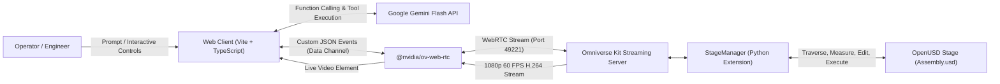

# Mechanical AI Digital Twin & Chatbot

[](https://www.nvidia.com/omniverse/)
[](https://openusd.org/)
[](https://webrtc.org/)
[](https://aistudio.google.com/)
[](https://vitejs.dev/)

An interactive industrial digital twin dashboard connecting a modern web client to a live **NVIDIA Omniverse Kit** USD PhysX/RTX ray-traced simulation of an automotive **Disc Brake Assembly** (`Assembly.usd`).

The web client renders the Kit viewport as a real-time, low-latency WebRTC video stream (1080p 60 FPS) and provides an autonomous **Mechanical AI Copilot** powered by Google Gemini Flash. The Copilot is directly grounded in the live OpenUSD stage through 14 bidirectional USD Scene API endpoints—supporting assembly hierarchy queries, millimeter dimension calculations, camera framing, interactive visibility toggles, real-time material editing, and arbitrary USD Python execution.

---

## Key Features

- **Authoritative OpenUSD Execution**: Live 3D stage (`Assembly.usd`) runs in NVIDIA Omniverse Kit with full CAD hierarchies, vertex/face geometries, and MDL/OmniPBR materials.
- **Hardware-Accelerated WebRTC Streaming**: Streams 1080p 60 FPS video directly to the browser via `@nvidia/ov-web-rtc` with camera orbit, pan, fly mode, and direct prim picking.
- **Autonomous Gemini Flash Copilot**: Natural-language CAD assistant with structured tool calling (`GEMINI_USD_TOOLS`) for live scene inspection, dimensional measurement, and stage modification.
- **Interactive Part Badges**: CAD components mentioned by the AI Copilot render as interactive chips (`.part-tag`). Clicking any part instantly selects and frames the 3D viewport camera on it.
- **Real-Time Material & Color Authoring**: Change material finishes (e.g., turning the brake caliper racing red or electric blue, binding anodized aluminum) live on the stage over the WebRTC data channel.
- **Millimeter Dimensional Analysis**: Authoritative physical measurements computed using `UsdGeom.BBoxCache`.
- **Dynamic Model Fallback**: Resilient model-switching engine (`gemini-3.8-flash`, `gemini-2.5-flash`, `gemini-1.5-flash`, `gemini-1.5-pro`) to seamlessly handle Google AI rate limits (HTTP 429/503).
- **One-Click Orchestration Scripts**: Windows batch scripts to build, start, and cleanly terminate both Kit and web services.

---

## Architecture Overview



For full architectural specifications, data channel message schemas, and implementation details, see [ARCHITECTURE.md](ARCHITECTURE.md).

---

## Repository Structure

```text
├── ARCHITECTURE.md                  # Detailed architectural blueprint & message schemas
├── README.md                        # Project documentation & quickstart
├── start_streaming_server.bat       # Launches Kit streaming server (Assembly.usd)
├── start_web_client.bat             # Starts Vite development server (Port 5173)
├── stop_all.bat                     # Cleanly terminates all processes
│
├── Model/                           # CAD Digital Twin Assets
│   ├── Assembly.usd                 # OpenUSD binary stage (Disc Brake Assembly)
│   └── Assembly.usda                # OpenUSD ASCII stage for inspection
│
├── Web_Front/                       # Frontend Web Application (Vite + TypeScript)
│   ├── src/
│   │   ├── main.ts                  # App lifecycle, stream setup, interactive delegation
│   │   ├── index.css                # Glassmorphism dark mode & NVIDIA green design system
│   │   └── services/
│   │       ├── usdSceneClient.ts    # WebRTC custom message Promise bridge
│   │       └── geminiService.ts     # Gemini Flash Copilot & CAD tools catalog
│   └── index.html                   # 3D viewport, chat drawer, prompt chips, API key modal
│
├── kit-app-template/                # Omniverse Kit Application & Custom Extensions
│   └── source/
│       ├── apps/
│       │   ├── my_company.my_usd_viewer.kit
│       │   └── my_company.my_usd_viewer_streaming.kit
│       └── extensions/
│           ├── my_company.my_usd_viewer_setup_extension/      # Stage auto-loading
│           └── my_company.my_usd_viewer_messaging_extension/  # StageManager USD APIs
│
```

---

## Quick Start

### Prerequisites

1. **Hardware**: NVIDIA RTX GPU (RTX 3070 / RTX 40-series or equivalent Quadro/RTX Ada) with up-to-date Game Ready or Studio Drivers.
2. **Software**:
   - Windows 10/11 64-bit
   - [Node.js](https://nodejs.org/) v20+ and npm v10+
   - [Git](https://git-scm.com/) with [Git LFS](https://git-lfs.github.com/)
3. **API Key**: Free Google Gemini API key from [Google AI Studio](https://aistudio.google.com/app/apikey).

### Installation & Launch

1. **Clone the Repository** (with Git LFS):
   ```bash
   git clone https://github.com/Goku3060/Mechnical_Ai_ChatBot.git
   cd Mechnical_Ai_ChatBot
   ```

2. **Start the Omniverse Kit Streaming Server**:
   ```cmd
   start_streaming_server.bat
   ```
   *Wait until the terminal displays `app ready` and `RTX ready` (approx. 20-30 seconds).*

3. **Start the Web Client**:
   In a separate terminal or by double-clicking:
   ```cmd
   start_web_client.bat
   ```
   Open your browser to [http://localhost:5173](http://localhost:5173).

4. **Connect AI Copilot**:
   - Click the **🔑 Gemini Key** button in the top navigation bar.
   - Enter your Google AI Studio API key and click **Test Connection** $\to$ **Save & Activate**.

5. **Shutdown**:
   ```cmd
   stop_all.bat
   ```

---

## Viewport Navigation Controls

- **Left Mouse Click**: Focus viewport / Select prim in 3D scene.
- **Middle Mouse Drag**: Pan camera.
- **Right Mouse Hold**: Fly Mode:
  - `W` / `S`: Move forward / backward
  - `A` / `D`: Strafe left / right
  - `Q` / `E`: Move down / up
  - `Mouse Scroll`: Adjust fly camera speed
- **Click Part Chip in Chat**: Instantly focus and frame camera on that mechanical part.

---

## License

Refer to [NVIDIA Omniverse License Agreement](https://docs.omniverse.nvidia.com/install-guide/latest/common/NVIDIA_Omniverse_License_Agreement.html).
Third-party submodules retain their respective upstream licenses.
